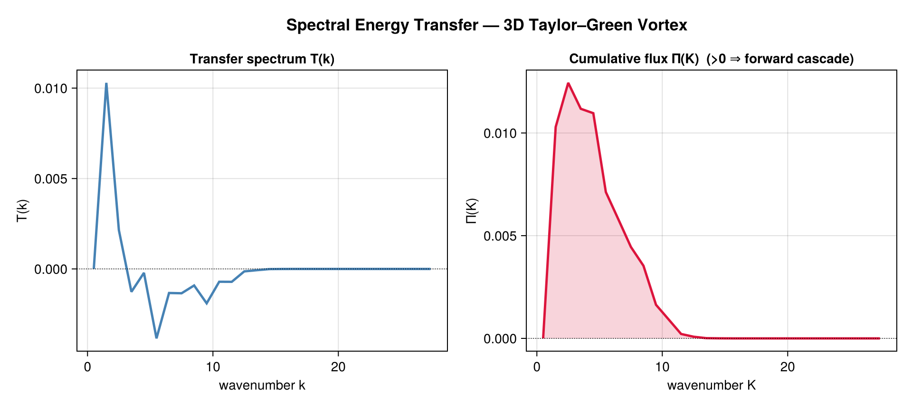
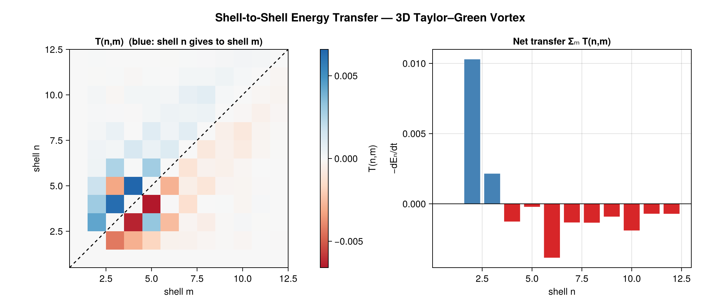
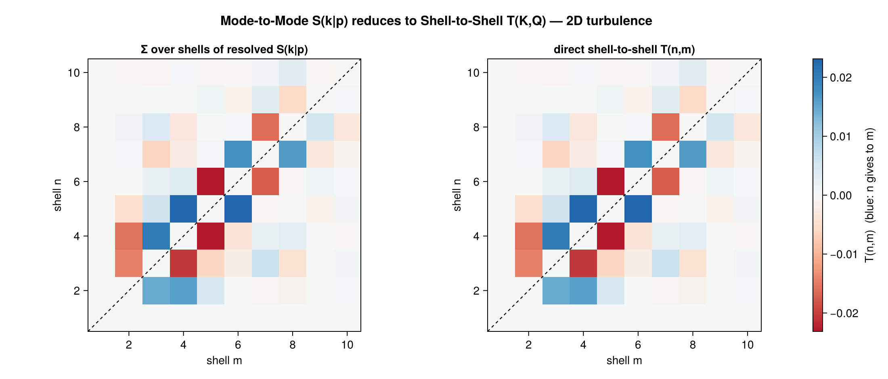
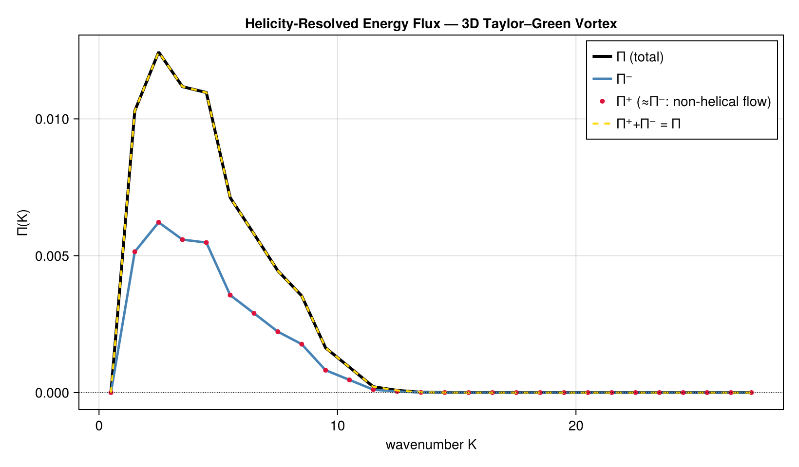
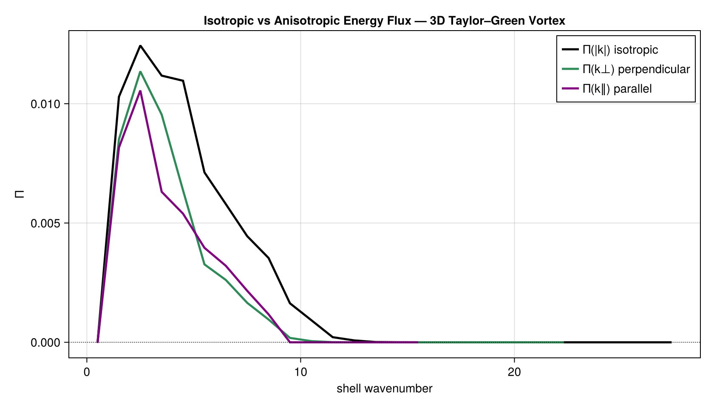
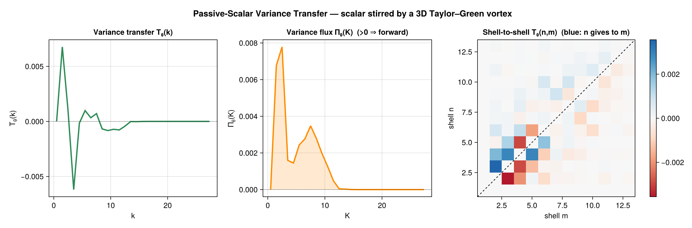
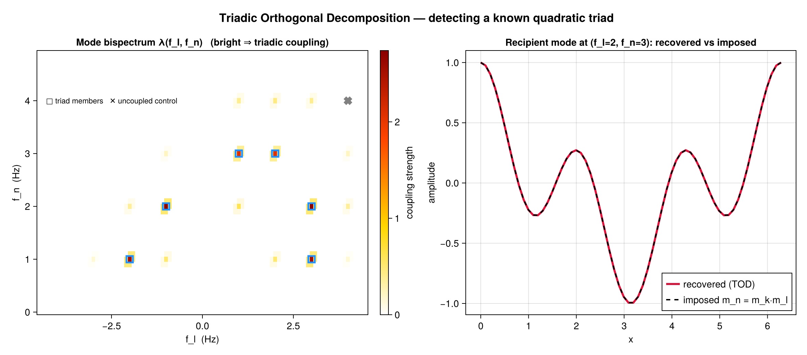
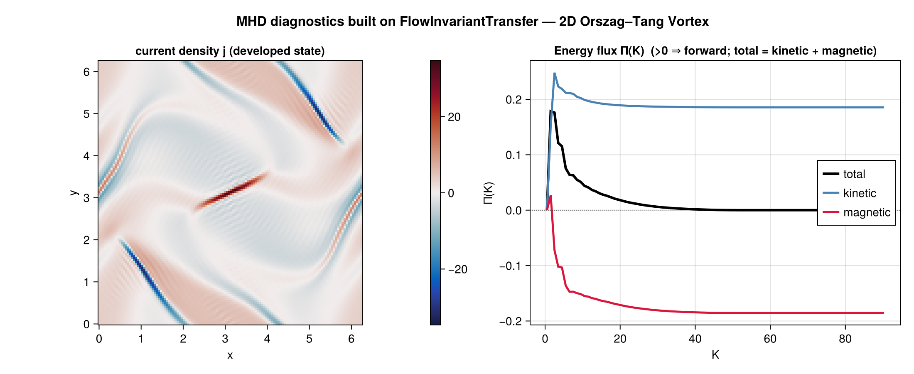
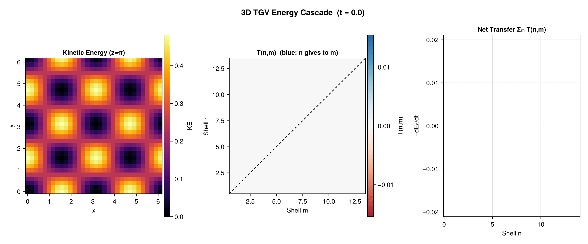

```@meta
CurrentModule = FlowInvariantTransfer
```

# FlowInvariantTransfer.jl

`FlowInvariantTransfer.jl` is a **general, domain-agnostic** toolkit for the cross-scale transfer
of quadratic inviscid invariants in turbulence. Its core is one validated pseudospectral nonlinear
term `(u·∇)f` — the advection of any field `f` by any velocity `u` — wrapped in generic reduction
machinery, field decompositions, anisotropic shell geometry, and a choice of exact dealiasing. It
applies equally to homogeneous turbulence, atmosphere/ocean flows, passive tracers, or abstract
fields; domain models (e.g. MHD) build *on top* of it. Works in 1D/2D/3D/N-D with the
velocity-component count decoupled from the spatial dimension (2D-3C flows are first-class), with an
allocating API and zero-allocation `!`-variants.

## Diagnostic Methods

| Method | Function | Output |
|--------|----------|--------|
| **Spectral flux** | [`calculate_spectral_flux`](@ref) | `T(k)`, `Π(K)` |
| **Shell-to-shell** | [`calculate_shell_to_shell_transfer`](@ref) | `T(n,m)` |
| **Mode-to-mode** | [`calculate_mode_to_mode_transfer`](@ref) | resolved `S(k\|p)` |
| **Smooth band-to-band** | [`calculate_band_to_band_transfer`](@ref) | `T(K,Q)` (graded bands) |
| **Partial fluxes** | [`calculate_partial_fluxes`](@ref) | `Π^{s_k s_p s_q}(K)` |
| **Coarse-graining** | [`calculate_coarse_graining_flux`](@ref) | `Π_ℓ(x)` |
| **TOD** | [`triadic_orthogonal_decomposition`](@ref) | mode bispectrum + modes |

The hierarchy is exact: `S(k|p)` → (sum over `p`) → `T(k)` → (cumsum) → `Π(K)`; and
`S(k|p)` → (sum over shells) → `T(n,m)`.

**Invariants** (`invariant=`): [`KineticEnergy`](@ref FlowInvariantTransfer.Types.KineticEnergy), [`Helicity`](@ref FlowInvariantTransfer.Types.Helicity), [`Enstrophy`](@ref FlowInvariantTransfer.Types.Enstrophy),
[`PassiveScalar`](@ref FlowInvariantTransfer.Types.PassiveScalar) (+ scalar convenience wrappers, and the buoyancy/APE & QG mapping).
**Decompositions** (`decomposition=`): [`HelmholtzDecomposition`](@ref FlowInvariantTransfer.Types.HelmholtzDecomposition),
[`HelicalDecomposition`](@ref FlowInvariantTransfer.Types.HelicalDecomposition), [`ToroidalPoloidalDecomposition`](@ref FlowInvariantTransfer.Types.ToroidalPoloidalDecomposition).
**Geometry** (`geometry=`): [`IsotropicShells`](@ref FlowInvariantTransfer.Types.IsotropicShells), [`PerpendicularShells`](@ref FlowInvariantTransfer.Types.PerpendicularShells),
[`ParallelShells`](@ref FlowInvariantTransfer.Types.ParallelShells). **Dealiasing** (`dealiasing=`): [`OrszagTwoThirds`](@ref FlowInvariantTransfer.Types.OrszagTwoThirds) (default),
[`NoDealiasing`](@ref FlowInvariantTransfer.Types.NoDealiasing), [`PaddedThreeHalves`](@ref FlowInvariantTransfer.Types.PaddedThreeHalves) (exact 3/2 padding).

---

## Installation

```julia
using Pkg
Pkg.add("FlowInvariantTransfer")
```

The direct-sum backend has no transform-library dependency. Load `FFTW` for `FFTSpectralBackend`
and other packages for optional features.

## Backends

Two orthogonal axes: **`transform`** (`DirectSumSpectralBackend`, `FFTSpectralBackend`, …)
× **`execution`** (parallelism: `SerialBackend`, `ThreadedBackend`,
`DistributedBackend`, `GPUBackend`).

| Diagnostic | Direct | FFT | Threaded | Distributed | GPU |
|-----------|:------:|:---:|:--------:|:-----------:|:---:|
| Spectral flux | ✓ | ✓ | ✓ | ✓ | ✓ |
| Shell-to-shell | ✓ | ✓ | ✓ | ✓ | ✓ |
| Mode-to-mode | ✓ | ✓ | ✓ | ✓ | ✓ |
| Band-to-band | ✓ | ✓ | ✓ | ✓ | ✓ |
| Partial fluxes | ✓ | ✓ | ✓ | ✓ | ✓ |
| Compressible | ✓ | ✓ | ✓ | ✓ | ✓ |
| TOD | ✓ | ✓ | ✓ | ✓ | ✓ |

See [Backends, Dealiasing & Extensions](@ref) for the authoritative matrix (with `Serial`, per-cell
notes, and the coarse-graining / spherical / MPI-batch+pencil layers).

---

## Quickstart: spectral flux Π(K)

The diagnostics take Fourier coefficients `û = fft(u)/Nᴰ` and their wavenumber axes `ks`; a real
field is stored as its non-redundant half (`rfft`). Physical fields on a grid go through
[`to_spectral`](@ref) (`using FlowFieldSpectra`). The snippets below run in order.

```julia
using FlowInvariantTransfer, FFTW
using FlowInvariantTransfer.Types: LinearBinning, PerpendicularShells, PaddedThreeHalves,
                                   TriadicOrthogonalDecompositionMethod
using FlowInvariantTransfer.SpectralBackends: FFTSpectralBackend
using FlowInvariantTransfer.Workspaces: ShellToShellWorkspace

# A real divergence-free 2-D velocity on the 2π-periodic box, as its half spectrum
N = 32; L = 2π
ks = FlowInvariantTransfer.Utils.wavenumber_grid(Float64, (N, N), (L, L))
kx = [k for k in ks[1], _ in ks[2]]; ky = [k for _ in ks[1], k in ks[2]]
ψ̂  = FFTW.rfft(randn(N, N)) ./ N^2
û  = cat(im .* ky .* ψ̂, -im .* kx .* ψ̂; dims = 3)   # (u, v) = (∂ψ/∂y, −∂ψ/∂x)

result = calculate_spectral_flux(û, ks; binning = LinearBinning(2π / L))
result.shell_edges        # shell n spans [shell_edges[n], shell_edges[n+1])
result.transfer_spectrum  # T(k_n) = −dE_n/dt from the nonlinear term
result.flux               # Π[n] = Σ_{m≤n} T(k_m), the flux through shell_edges[n+1]; > 0 forward
```

## Quickstart: shell-to-shell T(n,m)

```julia
r = calculate_shell_to_shell_transfer(û, ks; binning = LinearBinning(2π / L))
T = r.transfer_matrix      # T(n,m): the rate at which shell n gives energy to shell m
maximum(abs, T .+ T')      # round-off: T(n,m) = −T(m,n) for a divergence-free field
```

## Quickstart: mode-to-mode (resolved triads)

```julia
m = calculate_mode_to_mode_transfer(û, ks)     # (number of stored modes)² values
m.net_transfer  # T(k) = Σ_p S(k|p)
m.weights       # w(k): 2 inside the halved axis, where a stored mode stands for its mirror too
m.transfer      # S(k|p), with w(k)S(k|p) = −w(p)S(p|k)
```

## Quickstart: passive scalar

```julia
θ̂  = FFTW.rfft(randn(N, N)) ./ N^2
sf = calculate_scalar_flux(û, θ̂, ks; binning = LinearBinning(2π / L))
sf.flux        # Π_θ; Σ T_θ = 0 to round-off for a divergence-free velocity
```

## Quickstart: anisotropic + helical (3D)

```julia
M  = 16
k3 = FlowInvariantTransfer.Utils.wavenumber_grid(Float64, (M, M, M), (L, L, L))
q1 = [k for k in k3[1], _ in k3[2], _ in k3[3]]
q2 = [k for _ in k3[1], k in k3[2], _ in k3[3]]
q3 = [k for _ in k3[1], _ in k3[2], k in k3[3]]
  = [FFTW.rfft(randn(M, M, M)) ./ M^3 for _ in 1:3]
û3 = cat(im .* (q2 .* Â[3] .- q3 .* Â[2]), im .* (q3 .* Â[1] .- q1 .* Â[3]),
         im .* (q1 .* Â[2] .- q2 .* Â[1]); dims = 4)   # u = ∇ × A
b  = LinearBinning(2π / L)

# directional flux Π(k⊥)
Πperp = calculate_spectral_flux(û3, k3; binning = b, geometry = PerpendicularShells())

# helical 8-channel partial fluxes
hp = calculate_helical_partial_fluxes(û3, k3; binning = b)
hp.channels[(:positive, :positive, :positive)]  # homochiral: every field of the triad positive
hp.total              # Σ of the 8 channels: the flux of the solenoidal part of u
```

## Quickstart: exact 3/2 dealiasing

```julia
calculate_spectral_flux(û, ks; binning = b, dealiasing = PaddedThreeHalves())
```

## Quickstart: Triadic Orthogonal Decomposition

```julia
using FlowInvariantTransfer, FFTW
X = randn(256, 1, 32)                      # (nt, nvar, nx)
method = TriadicOrthogonalDecompositionMethod(nfft=64, noverlap=32, nmode=2)
result = calculate_energy_transfer(method, X; dt=0.01, transform=FFTSpectralBackend())
result.frequencies; result.mode_bispectrum; result.modes; result.modal_energy_budget
```

## Zero-alloc hot loop

```julia
ws = ShellToShellWorkspace(û, ks, LinearBinning(2π / L))
calculate_shell_to_shell_transfer!(r, ws, û, ks; transform = FFTSpectralBackend())  # 0 allocs
```

---

## Gallery

Every figure is produced by a script in `examples/` run on a **canonical evolved flow**, so the
physics is verifiable by eye. Run any with `julia --project=examples examples/<name>.jl`.

**Spectral flux `Π(K)` — forward energy cascade (3D Taylor–Green vortex).** `T(k) = −dE(k)/dt` is
positive at low `k`, where the large scales give energy; the cumulative flux `Π(K) > 0` across the
inertial range is the 3D forward cascade.



**Shell-to-shell `T(n,m)` (3D TGV).** `T(n,m)` is the energy shell `n` gives to shell `m` per unit
time: an antisymmetric near-diagonal band, and a net transfer `Σₘ T(n,m) = −dEₙ/dt` positive at low
shells and negative at high shells — the cascade resolved scale-by-scale.



**Mode-to-mode `S(k|p)` reduces to shell-to-shell `T(n,m)` (2D turbulence).** The resolved tensor
summed over shells (left) reproduces the directly-computed `T(n,m)` (right) — the reduction hierarchy.



**Helicity-resolved flux `Π±` (3D TGV).** `Π⁺ ≈ Π⁻` and `Π⁺+Π⁻ = Π` because the TGV is non-helical.



**Isotropic vs. anisotropic flux (3D TGV).** `Π(|k|)` vs. perpendicular `Π(k⊥)` and parallel
`Π(k∥)` directional fluxes from the anisotropic shell geometry.



**Passive-scalar variance transfer (scalar stirred by a 3D TGV).** The same engine on a different
quadratic invariant: `T_θ(k)`, `Π_θ(K)`, and the scalar shell-to-shell matrix.



**Triadic Orthogonal Decomposition — detecting a known quadratic triad.** The bispectrum lights up on
the imposed triad family (control stays dark); the recipient mode is recovered.



**MHD diagnostics built _on top_ of the public API (2D Orszag–Tang).** Total/kinetic/magnetic energy
fluxes assembled from public primitives, `total = kinetic + magnetic` — magnetism is not in the core.



## Cascade animation

Shell-to-shell `T(n,m)`, net transfer, and a KE slice for a 3D TGV (N=32³) developing from t=0 to
t=10 — the forward cascade building in time.



---

## See Also

- [Methods & Theory](@ref) — mathematical background for each diagnostic
- [Architecture](@ref) — internal design and dispatch
- [Backends, Dealiasing & Extensions](@ref) — backends and the extension table
- [API Reference](@ref) — full docstring index
